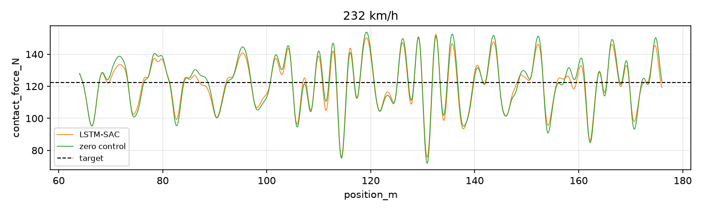
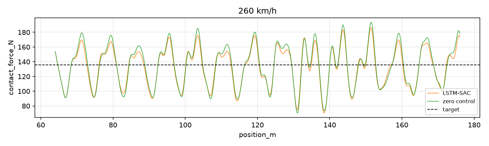

# 基于历史窗口编码 SAC 的刚性接触网受电弓主动控制

用 [PyTorch](https://pytorch.org) + [TorchRL](https://github.com/pytorch/rl) 在刚性接触网–受电弓仿真（PROCS，POMDP）上训练
LSTM-SAC（历史窗口 + 无状态 LSTM），控制下框架主动力，降低接触力波动；另含 PID 基线。

用 [pixi](https://pixi.sh) 管理。

## 环境依赖

```bash
pixi install
```

Python 3.12，主要依赖 `torch>=2.13`、`torchrl>=0.13`、`gymnasium`、`pandas`、`matplotlib`。

## 训练

```bash
pixi run python runs/run_lstm_sac.py train   # LSTM-SAC
```

## 测试

```bash
pixi run python runs/run_lstm_sac.py test \
  --model models/lstm_sac/250kmh/seed_1/best/best_model.pth \
  --speed 250 \
  --eval-seed 101

```

## LSTM-SAC 验证结果

### 232 km/h



| 控制方法 | 标准差 |
| -------- | ------ |
| 被动控制 | 15.98  |
| LSTM-SAC | 14.57  |

### 260 km/h



| 控制方法 | 标准差 |
| -------- | ------ |
| 被动控制 | 27.95  |
| LSTM-SAC | 25.62  |

## 对比

MLP-SAC 和 PID 算法作为对比算法
